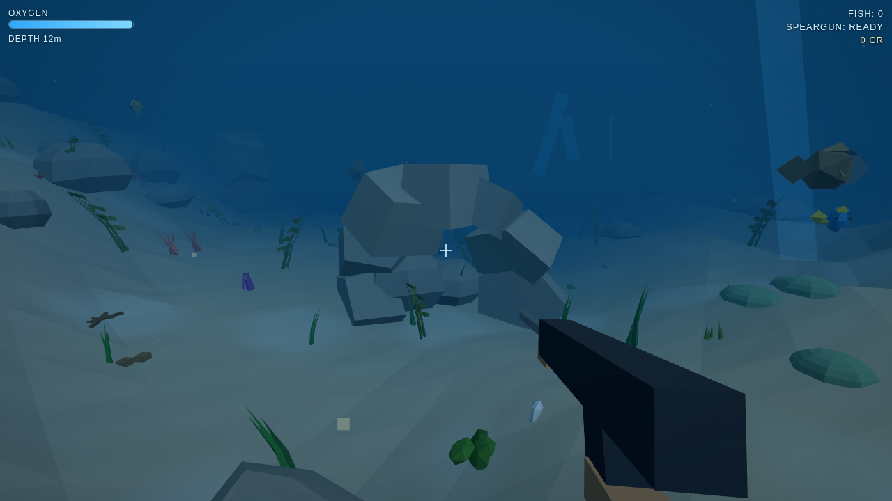

# Deep Sea Hunter

Deep Sea Hunter is a first-person low-poly underwater hunting game. Explore reefs, catch fish, manage oxygen and equipment, and return to Boat Hub.



## Features

- Three.js browser gameplay with fish AI, speargun, oxygen, equipment, missions, zones, and progression.
- Offline Guest play with local `dsh.save.v2` persistence.
- Online Guest sessions with a Fastify/PostgreSQL economy.
- Boat Hub, Fish Market, deterministic Dock Merchant orders, and separate offline/online balances.
- Optional NEAR Testnet collectible page and wallet integration.

Ordinary fish, game credits, and Merchant settlement remain off-chain. Meteor Wallet is optional and separate from game authentication. Google/Email account authentication and cross-device cloud saves are planned, not implemented.

## Technology

Three.js ES modules, vanilla browser APIs, Node.js, Fastify, PostgreSQL, Docker Compose, Rust, NEAR SDK, and optional Playwright browser tests.

## Project structure

```text
index.html, style.css     Browser game and UI
js/                       Game, UI, online, and wallet modules
server/src/               Fastify API and economy services
server/migrations/        Additive PostgreSQL migrations
server/test/              Backend tests
tests/                    Browser tests and visual fixtures
contracts/collectibles/   NEAR contract source, tests, sandbox, pinned WASM
docs/                     Architecture, API, and project status
```

## Requirements

- Node.js and npm
- Docker Compose
- Python 3 for the static frontend server
- Rust toolchain only when rebuilding the contract
- Chromium and Playwright only for browser tests

## Install and configure

```bash
npm ci
cp .env.example .env
```

Set a local PostgreSQL password in `.env`, and use the same password in `POSTGRES_PASSWORD`, `DATABASE_URL`, and `TEST_DATABASE_URL`. `.env.example` contains placeholders only. Never commit `.env`, wallet credentials, session tokens, or production secrets.

## Run locally

Start PostgreSQL and initialize the existing development database. Migrations are additive; do not reset a database volume containing user data.

```bash
docker compose up -d postgres
npm run migrate
npm run seed
docker compose up -d --build api
python3 -m http.server 8080 --bind localhost
```

Open `http://localhost:8080`. API endpoints: `http://127.0.0.1:3000/health` and `/ready`.

For an existing database, use its existing password. Keep API and frontend bound to loopback during local development. Browser ES modules require HTTP; `file://` is unsupported.

## Tests

Backend tests use randomized isolated PostgreSQL schemas when database integration tests are enabled:

```bash
npm test
```

With the API and frontend running, browser tests use local Playwright and Chromium paths:

```bash
TEST_DATABASE_URL=postgres://deepfish:<local-password>@127.0.0.1:5432/deepfish \
PLAYWRIGHT_MODULE=/absolute/path/to/playwright/index.mjs \
CHROMIUM_PATH=/absolute/path/to/chrome-headless-shell \
node tests/online-smoke.mjs

PLAYWRIGHT_MODULE=/absolute/path/to/playwright/index.mjs \
CHROMIUM_PATH=/absolute/path/to/chrome-headless-shell \
node tests/boat-hub.mjs

PLAYWRIGHT_MODULE=/absolute/path/to/playwright/index.mjs \
CHROMIUM_PATH=/absolute/path/to/chrome-headless-shell \
node tests/welcome-tutorial.mjs
```

`tests/wallet-login.mjs` uses a Wallet Selector mock for UI regression. It does not connect a real wallet or sign a transaction. Browser smoke covers desktop and mobile landscape viewports; real-device FPS, memory, and thermal behavior remain unverified.

## NEAR Testnet status

The pinned contract artifact is `contracts/collectibles/artifacts/deepfish_collectibles.mvp.wasm`.

```bash
sha256sum contracts/collectibles/artifacts/deepfish_collectibles.mvp.wasm
node contracts/collectibles/sandbox.mjs
```

Expected SHA-256:

```text
afb2bf590cc5b0d410e055386c9d714751f74f45b75dd3f53445477a8a63b3ae
```

The contract is deployed and initialized on NEAR Testnet as `deepfish-contract.testnet`. Its configured owner is `deepfish-owner.testnet`. Deployment and initialization are documented in `docs/PROJECT_STATUS.md`.

Real wallet connection, NFT minting, listing, buying, transfer, and signing are not claimed as end-to-end verified. Do not deploy, transact, or use private keys without explicit authorization. Contract `target/` output is ignored and can be rebuilt locally.

## Documentation

- [`ROADMAP.md`](ROADMAP.md): planned work and feature status.
- [`docs/ARCHITECTURE.md`](docs/ARCHITECTURE.md): system boundaries and data flows.
- [`docs/api-sessions-hunts.md`](docs/api-sessions-hunts.md): backend session and hunting API.
- [`docs/PROJECT_STATUS.md`](docs/PROJECT_STATUS.md): current evidence and known limits.
- [`docs/HACKATHON_OVERVIEW.md`](docs/HACKATHON_OVERVIEW.md): concise project overview.
